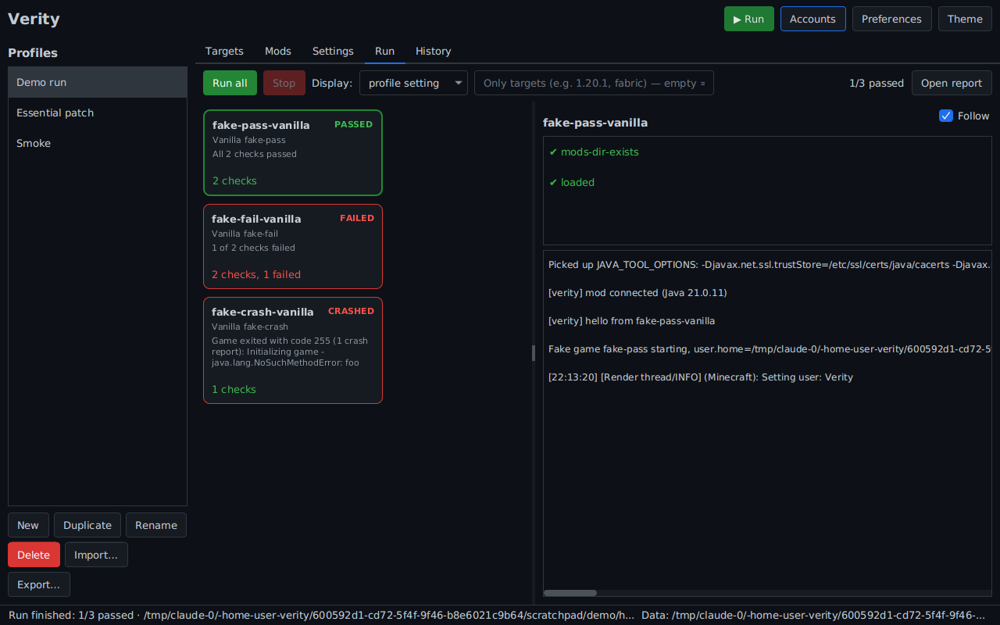

# Verity

Verity launches many Minecraft clients **in parallel** (vanilla, Fabric, Forge and NeoForge, from 1.7.10/1.8.9 to the
newest releases, year-numbered versions included), with or without a visible window. Use it to test mods and tweakers
that are meant to work across versions and loaders, such as
[minecraft-essential](https://github.com/prometheusreengineering/minecraft-essential), on every change. It replaces
testing each version and loader by hand.

- **One profile, many clients.** A profile holds the targets (versions × loaders), the mods, and every setting. Edit it
  once and every target uses the change.
- **Handles everything itself.** Verity downloads Minecraft, assets, libraries, Fabric/Forge/NeoForge (it runs the
  installers' processors itself) and the right Java runtime for each version into its own data folder. It never reads
  or writes your `.minecraft`, and by default game processes also get a sandboxed home/`APPDATA`.
- **Headless or headful.** Headless clients render for real but invisibly: one private Xvfb per client on Linux, or a
  hidden Win32 desktop per client on Windows, with Mesa software OpenGL for machines without a GPU (CI).
- **Real results.** Your mod reports checks through the tiny `verity-api` (Java 8, no dependencies, safe to shade).
  Crashes, early exits and timeouts fail the target, and crash reports are collected.
- **UI and CLI.** A JavaFX desktop app for day-to-day use, and a CLI plus GitHub Action for CI, with JUnit XML, JSON
  and self-contained HTML reports.



## Contents

- [Quick start](#quick-start)
- [Profiles](#profiles)
- [Reporting results from your mod (verity-api)](#reporting-results-from-your-mod-verity-api)
- [Mods from Modrinth](#mods-from-modrinth)
- [How mods are assigned to targets](#how-mods-are-assigned-to-targets)
- [Headless mode](#headless-mode)
- [Accounts](#accounts)
- [CLI reference](#cli-reference)
- [CI / GitHub Actions](#ci--github-actions)
- [Where things are stored](#where-things-are-stored)
- [Building from source](#building-from-source)
- [Limitations](#limitations)

## Quick start

Verity needs Java 21 to run. Each game client gets its own Java runtime, downloaded automatically: Java 8 for old
versions, 17/21 for new ones.

```bash
# Desktop app (from a release, or build it: ./gradlew :verity-app:shadowJar)
java -jar verity-<version>-linux.jar          # or verity-<version>-windows.jar

# CLI
java -jar verity-cli.jar profile new essential \
  -t 1.8.9:forge -t 1.12.2:forge -t 1.20.1:fabric -t 1.20.1:forge -t 1.21.1:neoforge \
  -m "/path/to/minecraft-essential/target/prometheus-*.jar" -m /path/to/essential-jars/
java -jar verity-cli.jar plan essential -v     # which jar goes where (dry run)
java -jar verity-cli.jar run essential         # run everything in parallel
```

On Linux, headless mode needs Xvfb and Mesa: `sudo apt install xvfb x11-xserver-utils libgl1-mesa-dri`.

The first run of each version downloads a few hundred MB, and Forge/NeoForge install steps take a minute or two.
Later runs reuse the cache.

## Profiles

Profiles are JSON files. The UI stores them in `<home>/profiles/`. A profile can also live in your mod's repository
(`verity.json`), where relative paths resolve against the file.

```jsonc
{
  "name": "essential",
  "targets": [
    { "minecraft": "1.8.9",  "loader": "forge" },                              // loaderVersion: recommended (default)
    { "minecraft": "1.20.1", "loader": "fabric", "loaderVersion": "0.16.14" }, // pinned
    { "minecraft": "latest" },                                                 // newest vanilla release
    { "select": { "minecraft": ">=1.20", "loaders": ["fabric", "neoforge"], "latestPatchOnly": true } }
  ],
  "mods": [
    { "path": "target/prometheus-*.jar" },               // glob: re-evaluated each run, so rebuilt jars are picked up
    { "path": "deps/essential/" },                       // folder: every jar inside, matched per target
    { "path": "deps/old-lib.jar", "loaders": ["forge"], "minecraft": "<=1.12.2" },  // manual rule
    { "modrinth": "essential" }                          // Modrinth: right file per target, plus required deps
  ],
  "files": [ { "from": "test-configs/essential.json", "to": "essential/config.json" } ],
  "jvm":     { "memoryMb": 2048, "args": ["-Dmymod.debug=true"] },
  "game":    { "args": [], "env": {} },
  "display": { "mode": "headless", "width": 854, "height": 480, "softwareGl": "auto" },
  "account": { "type": "offline", "username": "Verity" },
  "test":    { "startupTimeoutSec": 600, "timeoutSec": 900, "shutdownGraceSec": 10, "vanillaSmokeSec": 60, "smokeSec": 0 },
  "run":     { "maxParallel": 0, "keepInstances": false, "isolateHome": true, "onlyTargetsWithAllMods": false }
}
```

| Setting | Meaning |
|---|---|
| `targets[].loaderVersion` | `recommended` (Forge promotion, newest stable Fabric/NeoForge), `latest`, or an exact version |
| `targets[].select.minecraft` | Version range: `>=1.20`, `1.20.x`, `>=1.16 <1.21`, `~1.20.1`, `[1.8.9,1.12.2]`, `1.8.9 \|\| >=1.21`, `latest`, `*` |
| `select.latestPatchOnly` / `limit` | Keep only the newest patch of each minor line, and/or the N newest versions |
| `select.modrinth` | Modrinth projects: keep only the (version, loader) pairs all of them publish files for |
| `mods[].path` / `mods[].modrinth` | A local file/folder/glob, or a Modrinth project slug/id (exactly one per entry) |
| `mods[].match` | `auto` (use jar metadata), `always`, `never` |
| `mods[].version` / `channel` / `dependencies` | Modrinth only: pin a version, allow `beta`/`alpha` builds, install required dependencies (default on) |
| `display.mode` | `headless` (invisible, real rendering) or `window` |
| `display.softwareGl` | `auto`, `on`, `off`: Mesa llvmpipe instead of the GPU driver |
| `test.startupTimeoutSec` | The mod must connect through verity-api within this time |
| `test.timeoutSec` | `Verity.finish()` must be called within this time |
| `test.vanillaSmokeSec` | Vanilla can't load mods, so a vanilla client passes after running this long without crashing (0 = require the hook) |
| `test.smokeSec` | Modded targets pass after running this long without crashing, unless the mod reports through verity-api (0 = the mod must report) |
| `run.onlyTargetsWithAllMods` | Skip targets where some mod entry has no file. Skipped targets don't fail the run |
| `run.maxParallel` | Clients at once. `0` = automatic: half the CPU cores, limited by memory |
| `run.keepInstances` | Keep worlds/configs between runs instead of starting each client fresh |
| `run.isolateHome` | Point `user.home`, `HOME`/`APPDATA` into the instance |

Every target is one client: `1.20.1-fabric` → `<home>/instances/<profile>/1.20.1-fabric/game` is its game directory.

## Reporting results from your mod (verity-api)

Verity can't tell whether *your* mod worked unless the mod reports it, so the main pass/fail signal comes from inside
the game. `verity-api` is a single class with no dependencies that compiles for Java 8. It doesn't touch Minecraft or
loader classes, so it behaves the same everywhere. When the game wasn't started by Verity, every call does nothing,
so you can leave the calls in release builds.

```java
import dev.verity.api.Verity;

// e.g. at the end of your initialization, or once your universal adapter has resolved the game classes
Verity.test("adapter resolves Minecraft classes", () -> {
    if (Adapter.minecraftClass() == null) throw new AssertionError("not resolved");
});
Verity.pass("mixins applied");
Verity.fail("cosmetics unlocked", "expected 120, got 0");
Verity.log("detected Minecraft " + Adapter.version());
Verity.attach("dump.json", bytes);   // shows up in the report
Verity.finish();                     // done: Verity records the result and closes the game
```

A target passes when `finish()` is called and none of its checks failed. It fails if the game crashes, exits before
`finish()`, never connects (`startupTimeoutSec`), or doesn't finish in time (`timeoutSec`).

**Getting the API.** Copy the single source file into your mod under your own package, or take `verity-api-<v>.jar`
from a release (or run `./gradlew :verity-api:publishToMavenLocal`) and shade it. **If you shade it, relocate it** (for example to
`your.mod.shadow.verity`): on Forge 1.17+ and NeoForge, two jars containing the same package won't load. See
[docs/integrating-minecraft-essential.md](docs/integrating-minecraft-essential.md) for a Maven example.

`samples/testmod` is a complete universal example: one jar that loads on Fabric, legacy Forge (1.7.10–1.12.2), modern
Forge and NeoForge without depending on any Minecraft class.

## Mods from Modrinth

A mod entry can name a Modrinth project instead of a file. For every target, Verity picks the newest file that
project published for that Minecraft version and loader (release builds unless `"channel": "beta"`/`"alpha"`, or a
pinned `"version"`). It also adds the file's required dependencies, such as Fabric API, and downloads everything into
`<home>/mods-cache`. NeoForge 1.20.1 falls back to the project's Forge files.

To run on exactly the versions a project supports, give a selector `"modrinth": [...]`. For example, to test a
universal mod you build yourself against every version and loader Essential is published for:

```json
{ "name": "prometheus-x-essential",
  "targets": [ { "select": { "modrinth": ["essential"] } } ],
  "mods": [ { "path": "target/prometheus-*.jar" },
            { "modrinth": "essential" } ],
  "run":  { "onlyTargetsWithAllMods": true },
  "test": { "smokeSec": 180 } }
```

- The selector can be narrowed with `"minecraft"` (a range), `"loaders"`, `"latestPatchOnly"` and `"limit"`. With
  several projects it keeps only the pairs all of them support.
- `onlyTargetsWithAllMods` is the safety net for any target list, not just Modrinth selectors. A target where some
  entry contributes no jar (for example, your own mod's metadata excludes that version) is reported as skipped
  instead of running without it.
- `smokeSec` makes a modded client pass once it has survived that long, for mods that don't call verity-api yet.

CLI equivalents: `verity profile new <name> --select-modrinth essential --modrinth essential -m "target/*.jar"
--only-with-all-mods --smoke 180`. `verity modrinth versions essential` lists what a project supports, and
`verity plan <profile>` shows the file picked for each target. In the app, use **Mods → Add from Modrinth…** and the
**Only on Modrinth for** field in the Targets range dialog.

## How mods are assigned to targets

Projects like Essential ship a different jar per version and loader. Verity reads each jar's metadata and installs it
only where it fits:

| Metadata | Read from | Applies to |
|---|---|---|
| `fabric.mod.json` (`depends.minecraft`) | Fabric | Fabric targets |
| `META-INF/mods.toml` (`minecraft` versionRange) | Forge 1.13+ | Forge 1.13+, NeoForge 1.20.1 |
| `META-INF/neoforge.mods.toml`, or `mods.toml` depending on `neoforge` | NeoForge | NeoForge |
| `mcmod.info` (`mcversion`), `TweakClass`/`FMLCorePlugin` manifest | LaunchWrapper Forge | Forge ≤ 1.12.2 |

- A jar whose metadata for the target's loader excludes the version is skipped.
- A jar with metadata for exactly one *other* loader is skipped. A multi-loader jar is installed everywhere.
- Jars without any metadata (plain libraries) go everywhere except vanilla.
- An entry with manual rules (`loaders`, `minecraft`) or `match: always` ignores metadata.

`verity plan <profile> -v` and the **Mods** tab's preview show the decision and the reason for every jar on every
target.

## Headless mode

| OS | How |
|---|---|
| Linux | One `Xvfb` server per client (`-displayfd`, so there are no display-number races) with Mesa llvmpipe. Requires `xvfb`, `libgl1-mesa-dri` and, for ≤1.12.2 (LWJGL 2), `x11-xserver-utils` (provides `xrandr`). |
| Windows | Each client runs on its own hidden Win32 desktop (`CreateDesktop`), so windows never appear or steal focus. GPU drivers often won't accelerate a desktop that isn't displayed, so `softwareGl: auto` uses Mesa ([mesa-dist-win](https://github.com/pal1000/mesa-dist-win), downloaded once) by launching the game from a copy of its Java runtime with Mesa's `opengl32.dll` next to `java.exe`. This works for LWJGL 2 and 3 and on GPU-less CI runners. |
| macOS | Not a target platform. `headless` falls back to normal windows. |

Use `--display window` (or the profile setting) to watch the clients.

## Accounts

Profiles use offline accounts by default, so no login is needed. To test features that need Mojang/Microsoft services:

```bash
verity account login          # device code: open microsoft.com/link and enter the code
verity account list
```

Then set `"account": {"type": "msa"}` (plus `"id"` if several accounts are stored). Tokens are stored in
`<home>/accounts/accounts.json`, readable only by the owner on Linux. For CI, store the output of
`verity account ci-token <name>` in a secret and expose it as `VERITY_MSA_REFRESH_TOKEN`.

## CLI reference

```text
verity run <profile|file> [--only 1.20.1-fabric,1.8.9] [--parallel N] [--display headless|window]
                          [--report-dir DIR] [--[no-]keep-instances] [--logs]
verity prepare <profile>        install everything, don't launch (CI cache warm-up)
verity plan <profile> [-v] [--resolve]
verity profile list | show <p> | new <name> -t MC[:LOADER[:VERSION]] -m PATH [--modrinth PROJECT[@VERSION]]
               [--select RANGE --loaders a,b --latest-patch] [--select-modrinth PROJECT,...] [--only-with-all-mods]
               [--smoke SECONDS] | rm <p> | import <file> | export <p> <file>
verity modrinth search <query> | versions <project> [--mc 1.20.1 --loader fabric] [--channel beta]
verity versions [vanilla|fabric|forge|neoforge] [--mc 1.20.1]
verity account login | list | rm <name> | ci-token <name>
verity cache info | clean [--all] [--meta]
verity ui
Global: --home DIR (or VERITY_HOME)
Exit codes: 0 all passed (skipped targets don't count) · 1 some target failed · 2 configuration error · 3 internal error
```

## CI / GitHub Actions

Add a `verity.json` to your mod repository and use the action:

```yaml
jobs:
  verity:
    strategy:
      matrix:
        os: [ubuntu-latest, windows-latest]
    runs-on: ${{ matrix.os }}
    steps:
      - uses: actions/checkout@v4
      - run: mvn -B package            # build your mod
      - uses: prometheusreengineering/verity@v0.1.0
        with:
          profile: verity.json
          # only: "1.8.9,1.20.1-fabric"
          # parallel: "3"
```

The action installs Xvfb/Mesa on Linux, caches the Minecraft/loader/Java downloads between workflow runs, writes a
results table to the job summary, uploads the reports as an artifact, and fails the job if any target fails.
`.github/workflows/ci.yml` runs Verity's own end-to-end matrix with `samples/testmod`.

The cache is one entry per OS and profile, renewed weekly. To split a profile across jobs with `only`, add a prepare
job per OS first, because jobs that use `only` restore the cache but don't save it. A prepare job does nothing when the
cache is already complete, and `continue-on-error` lets the tests run (and download what they need) if it fails:

```yaml
jobs:
  prepare:
    continue-on-error: true
    strategy:
      matrix:
        os: [ubuntu-latest, windows-latest]
    runs-on: ${{ matrix.os }}
    steps:
      - uses: actions/checkout@v4
      - run: mvn -B package            # the profile's mods must exist
      - uses: prometheusreengineering/verity@v0.1.0
        with:
          mode: prepare
          profile: verity.json
  verity:
    needs: prepare
    strategy:
      matrix:
        os: [ubuntu-latest, windows-latest]
        loader: [fabric, forge, neoforge]
    runs-on: ${{ matrix.os }}
    steps:
      - uses: actions/checkout@v4
      - run: mvn -B package
      - uses: prometheusreengineering/verity@v0.1.0
        with:
          profile: verity.json
          only: ${{ matrix.loader }}
```

## Where things are stored

`%LOCALAPPDATA%\Verity` on Windows, `$XDG_DATA_HOME/verity` (`~/.local/share/verity`) on Linux, or `--home` /
`VERITY_HOME`:

```text
libraries/ assets/ versions/ runtimes/ installers/ tools/   shared caches (safe to delete)
mods-cache/                                                 mods downloaded from Modrinth
meta-cache/                                                 version lists (cached, work offline once fetched)
profiles/  accounts/  settings.json                         your configuration
instances/<profile>/<target>/{game,natives,home}            one isolated directory per client
runs/<timestamp>-<profile>/                                 report.html, report.json, junit.xml, targets/<id>/…
```

Each target's report folder contains `output.log` (raw stdout/stderr), `console.log` (readable), `latest.log`,
`command.txt` (the exact java command, token redacted), `crash-reports/` and `attachments/`.

## Building from source

```bash
./gradlew build                         # all modules + unit tests (incl. an end-to-end run with fake game JVMs)
./gradlew :verity-app:run               # start the UI
./gradlew :verity-cli:shadowJar         # verity-cli/build/libs/verity-cli-<v>-all.jar (no JavaFX, for CI)
./gradlew :verity-app:shadowJar         # verity-app/build/libs/verity-<v>-<os>.jar (UI + CLI)
./gradlew :verity-app:jpackageImage     # self-contained app image with bundled Java
./gradlew :samples:testmod:shadowJar    # the universal sample mod
```

| Module | Contents |
|---|---|
| `verity-api` | The Java 8 test-hook API mods use |
| `verity-core` | Metadata, installers (vanilla/Fabric/Forge/NeoForge), Java runtimes, launching, displays, mod assignment, orchestration, reports |
| `verity-cli` | picocli command line |
| `verity-ui` | JavaFX UI (AtlantaFX theme) |
| `verity-app` | Entry point: UI without arguments, CLI otherwise |
| `samples/testmod` | Universal sample mod and Verity's own e2e profile |

## Limitations

- Forge/NeoForge versions are installed by Verity running the official installer's steps. Releases whose installers
  don't follow the standard formats (some very old 1.7.10 builds) may fail; pin a different `loaderVersion` in that
  case.
- Fabric targets need versions Fabric supports (1.14+). Legacy Fabric and Quilt are not supported yet.
- macOS can run clients only in windowed mode.

## Disclaimer

This project is intended for educational purposes only. We are not responsible for any damage caused by this project.

Assets belong to their respective owners. This project is not affiliated with Lunar Client, Moonsworth, Dawn Client, Essential or ModCore.

This project was made almost entirely with Claude Opus 5.5 on Medium/High effort.

## License

GPLv3 © Prometheus Reengineering
